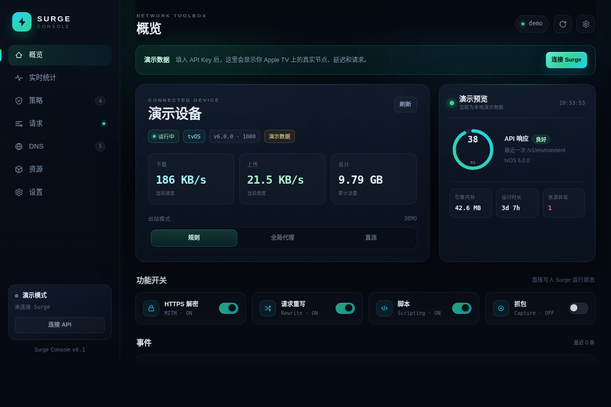

# Surge Console

基于 Surge HTTP API 的轻量 Web 控制台，用来查看 Surge 的运行状态、实时流量、策略组、请求、DNS 缓存和外部资源，并管理常用功能开关。

纯静态前端，无框架、无构建步骤，直接部署 `index.html`、`app.js`、`styles.css` 即可。



> 截图使用演示数据，仅用于展示界面。

## 在线示例

[https://surgeweb.dokii.xx.kg](https://surgeweb.dokii.xx.kg)

> 示例站只包含前端，不保存 Surge 凭据。连接时请填写你自己的 API 地址和 Key；不建议在公共示例中输入生产环境的 Key。

## 功能

- **概览**：设备状态、API 延迟、下载/上传/总计流量、功能开关、事件日志、最近请求。
- **实时统计**：实时速率曲线、网络接口/策略维度流量、当前/最高速度、表头多列排序。
- **策略**：策略组与节点、当前选中节点、延迟测试、单列/双列独立列瀑布流布局。
- **请求**：最近/活动请求、URL/策略/规则过滤、请求详情（一般/请求/计时）、结束活动连接。
- **DNS**：动态/静态 DNS 记录查看与查询。
- **资源**：外部资源状态与手动更新。
- **设置**：Surge HTTP API 地址、API Key、出站模式、MITM/Rewrite/Scripting/Capture 开关、配置文件查看。

## 技术栈

- 原生 HTML / CSS / JavaScript
- Surge HTTP API（`/v1/...`）
- 浏览器 `localStorage` / `sessionStorage` 保存连接配置

## 快速开始

在项目目录启动一个静态文件服务器：

```bash
python3 -m http.server 8899 --bind 0.0.0.0
```

然后打开 `http://<host>:8899/`，在连接弹窗中填写：

- **API 地址**：例如 `http://<Apple-TV-IP>:6171`，替换成 Apple TV 的局域网 IP
- **API Key**：Surge 配置中 `http-api` 的 key

勾选“记住”后，Key 会保存在浏览器 `localStorage`；不勾选则只保存在当前会话。

## 目录结构

```text
.
├── index.html      # 页面骨架与连接弹窗
├── app.js          # 路由、API 封装、各页面渲染
├── styles.css      # 深色主题与响应式布局
├── docs/
│   └── overview.png
└── README.md
```

## 依赖的 Surge API

- `/v1/outbound`
- `/v1/features/{mitm,rewrite,scripting,capture}`
- `/v1/requests/{recent,active,kill}`
- `/v1/policies`
- `/v1/policy_groups`
- `/v1/policy_groups/select`
- `/v1/policy_groups/test`
- `/v1/policies/benchmark_results`
- `/v1/traffic`
- `/v1/dns`
- `/v1/external_resources`
- `/v1/events`
- `/v1/profiles/current`
- `/v1/metrics`

不同 Surge 版本/平台对部分接口支持不同；请求头、计时等字段通常需要开启 HTTP Capture 或 MITM。

## 说明

- 本项目只做前端展示与控制，不代理流量，也不保存服务端数据。
- API Key 仅保存在浏览器本地，不会上传到第三方。
- 界面按桌面端设计，窄屏会自动切为单列布局。

## License

本项目采用 [MIT License](LICENSE)。
